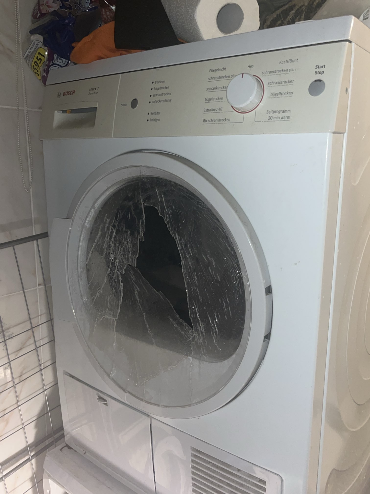

# Trockner reparieren

- **Status:** 📋 Geplant (Diagnose: Riemen)
- **Priorität:** mittel
- **Raum:** Bad
- **Budget:** Riemen ca. 10–20 €, Türteil je nach Ersatzteil

## Gerät
- **Bosch Maxx 7 Sensitive**, Kondenstrockner, E-Nr. **WTE86103/32**, FD 9111 (= Baujahr ca. Nov. 2009)
- Ersatzteile über die E-Nr. suchen

## Probleme
1. **Äußere Kunststoffscheibe der Tür** ist porös geworden und zerbröselt. Die innere Glasscheibe ist in Ordnung
2. **Trommel dreht sich nicht**, das Gerät heizt aber und läuft. Verdacht: **Riemen gerissen**

## ⚠️ Bis zur Reparatur
- Trockner **nicht benutzen**: Er heizt, ohne dass sich die Trommel dreht. Dann kann die Wäsche an einer Stelle überhitzen
- Lose Kunststoffsplitter an der Tür vorsichtig entfernen, weil sie scharfkantig sind

## Diagnose
- [x] Stecker ziehen. **Trommel von Hand drehen** (21.11.2026, Video): Die Trommel dreht sich mit leichten Handstößen mühelos → **Riemen sehr wahrscheinlich gerissen**
  - lässt sich **ganz leicht** und ohne Widerstand drehen → Riemen ist gerissen oder abgesprungen
  - spürbarer Widerstand → Riemen ist wahrscheinlich in Ordnung, dann Spannrolle oder Motor prüfen
- [ ] Beim Einschalten horchen: Läuft der Motor bzw. das Gebläse (Rauschen, Luftzug)?

## Aufgaben
- [ ] Passenden Riemen über die E-Nr. bestellen (Länge steht auf dem alten Riemen, z. B. „1965 H7“)
- [ ] Deckel und Front abbauen, Riemen um Trommel, Motorrolle und Spannrolle legen (Anleitungsvideo zum Modell suchen)
- [ ] Wenn das Gerät offen ist: **Flusen aus dem Innenraum saugen** (nach 17 Jahren Brandgefahr!)
- [ ] Wärmetauscher (Kondensator, Klappe unten links) ausspülen
- [ ] Ersatzteil für die äußere Türscheibe bzw. den Türring über die E-Nr. suchen und Preis prüfen
- [ ] Alternative: **Scheibe selbst machen** (siehe unten), wenn das Original teuer ist

## Recherche Ersatzteil Tür (21.11.2026)
- **00445420 „Türglas“** ist das **innere Glas-Bullauge** (Glas, ca. 2,5 kg) und **nicht** die äußere Kunststoffscheibe
- Bei manchen Händlern wird ein **„Türring außen, weiß“** für WTE86103/30–/47 angeboten. Unklar ist, ob er die Klarsichtscheibe enthält ([Nettoparts](https://www.nettoparts.de/shop/turring-bosch-waschetrockner-65649p.html))
- ✅ **Richtiges Teil: 00661324** „Türglas / Abdeckung Tür außen“: die runde, durchsichtige äußere Abdeckung. Für WTE86103/32 gelistet. Preis ca. 43–50 € ([fixpart](https://fixpart.de/produkt/bosch-siemens-00661324-turglas-trockner), [ersatzteilshop.de](https://www.ersatzteilshop.de/ersatzteile-fuer/bosch/wte86103-32.html)). **Einen Durchmesser nennt kein Händler**, deshalb selbst messen
- Am sichersten: Explosionszeichnung zur E-Nr. **WTE86103/32** ansehen oder einen Händler bzw. den BSH-Kundendienst mit E-Nr., FD und Foto fragen

## Anbieter für runde Polycarbonat-Zuschnitte
| Anbieter | Hinweis |
|---|---|
| [kunststoffplattenonline.de](https://kunststoffplattenonline.de/polycarbonat-platten/formen/) | Konfigurator mit Form „Kreis“, auch DXF-Upload |
| [glacryl.de](https://glacryl.de/polycarbonat-zuschnitt-pc) | ab 1 mm, bohrt und bearbeitet Kanten, schon ab 1 Stück |
| [acrylglas-shop.com](https://acrylglas-shop.com/polycarbonat-makrolon) | Zuschnitt nach Maß, Kanten wählbar |
| [plattenzuschnitt24.de](https://www.plattenzuschnitt24.de/Polycarbonat-Zuschnitt/) | 2–10 mm, ob Kreise möglich sind: anfragen |
| [eBay: Makrolon-Kreise](https://www.ebay.de/itm/204971469933) | Kreise Ø 300–700 mm |

## Türscheibe selbst machen
- Material: **Polycarbonat** (Makrolon), klar, 2–3 mm dick. Es verträgt Hitze bis ca. 120 °C und bricht nicht. Acrylglas wird bei Wärme eher spröde und reißt
- [ ] Tür abschrauben und zerlegen (Schrauben innen am Türrand): Wie ist die alte Scheibe befestigt (Clips, Schrauben, eingeklemmt)? Ist sie **flach oder gewölbt**?
- [ ] Durchmesser und Dicke messen, Befestigungspunkte und Aussparungen abzeichnen
- [ ] Zuschnitt: Bei einem Online-Zuschnittservice „rund“ bestellen (am saubersten) oder selbst mit der Stichsäge (feines Kunststoffblatt, niedrige Drehzahl, Schutzfolie dranlassen)
- [ ] Kanten mit Schleifpapier entgraten, Löcher langsam bohren
- Die Scheibe schützt auch davor, sich am heißen Innenglas zu verbrennen, sie sollte also wieder rein
- [ ] Testlauf

## Optional: vergilbtes Plastik aufhellen
- [ ] Erst gründlich reinigen (Fettlöser, vorsichtig mit dem Schmutzradierer). Oft ist ein Teil der Verfärbung nur Schmutz
- [ ] Wenn es danach noch gelb ist: „Retrobright“, also **Wasserstoffperoxid-Creme 12 %** (Friseurbedarf, „Oxidant/Entwickler“) dünn auftragen, mit Frischhaltefolie abdecken und 4–8 h in die Sonne oder unter eine UV-Lampe legen. Danach abspülen
- Nur abgebaute Teile behandeln und zuerst an einer versteckten Stelle testen, besonders bei bedruckten Blenden
- Handschuhe und Schutzbrille tragen. Das Plastik kann spröder werden und nach Jahren wieder vergilben

## Material & Kosten
| Was | Wo | Preis | Gekauft |
|---|---|---|---|
| Riemen | | | |
| Türteil außen | | | |

## Notizen & Entscheidungen
- Gleiche Linie wie bei der Waschmaschine? Günstige Reparaturen wie Riemen oder Türteil ja, teure nein
