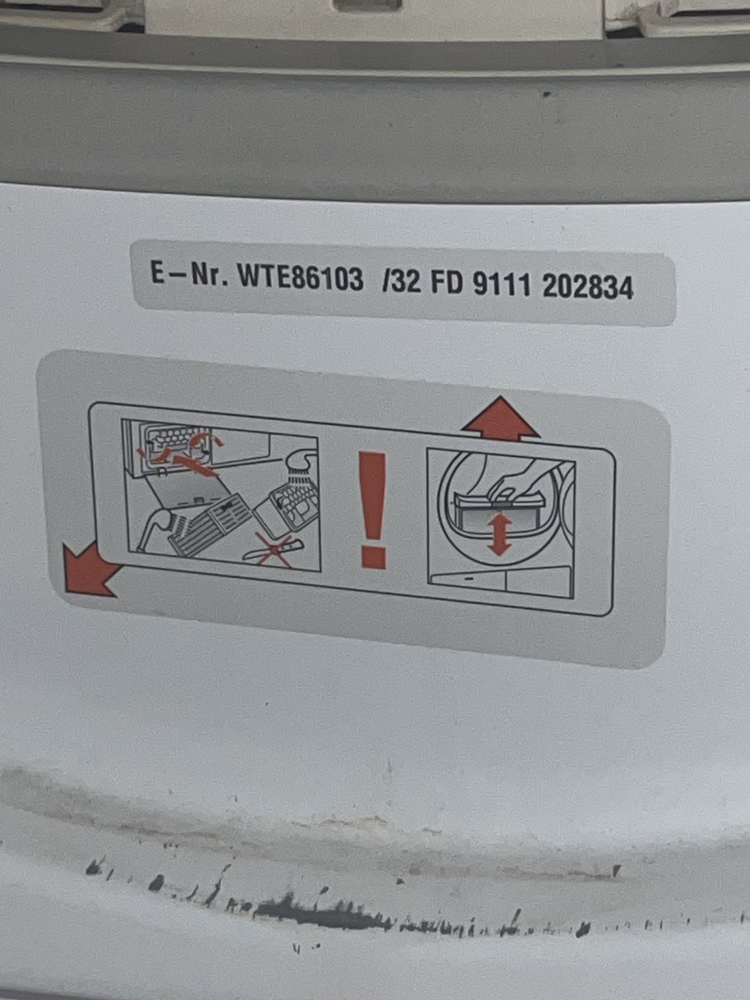

# Trockner reparieren

- **Status:** 📋 Geplant (Diagnose: Riemen)
- **Priorität:** mittel
- **Raum:** Bad
- **Budget:** Riemen ca. 10–20 €, Türteil je nach Ersatzteil

## Gerät
- **Bosch Maxx 7 Sensitive**, Kondenstrockner, E-Nr. **WTE86103/32**, FD 9111 (= Baujahr ca. Nov. 2009)
- Ersatzteile über die E-Nr. suchen

## Probleme
1. **Äußere Kunststoffscheibe der Tür** ist porös geworden und zerbröselt. Die innere Glasscheibe ist in Ordnung
2. **Trommel dreht sich nicht**, das Gerät heizt aber und läuft. Verdacht: **Riemen gerissen**

## ⚠️ Bis zur Reparatur
- Trockner **nicht benutzen**: Er heizt, ohne dass sich die Trommel dreht. Dann kann die Wäsche an einer Stelle überhitzen
- Lose Kunststoffsplitter an der Tür vorsichtig entfernen, weil sie scharfkantig sind

## Diagnose
- [x] Stecker ziehen. **Trommel von Hand drehen** (21.11.2026, Video): Die Trommel dreht sich mit leichten Handstößen mühelos → **Riemen sehr wahrscheinlich gerissen**
  - lässt sich **ganz leicht** und ohne Widerstand drehen → Riemen ist gerissen oder abgesprungen
  - spürbarer Widerstand → Riemen ist wahrscheinlich in Ordnung, dann Spannrolle oder Motor prüfen
- [ ] Beim Einschalten horchen: Läuft der Motor bzw. das Gebläse (Rauschen, Luftzug)?

## Aufgaben
- [ ] Passenden Riemen über die E-Nr. bestellen (Länge steht auf dem alten Riemen, z. B. „1965 H7“)
- [ ] Deckel und Front abbauen, Riemen um Trommel, Motorrolle und Spannrolle legen (Anleitungsvideo zum Modell suchen)
- [ ] Wenn das Gerät offen ist: **Flusen aus dem Innenraum saugen** (nach 17 Jahren Brandgefahr!)
- [ ] Wärmetauscher (Kondensator, Klappe unten links) ausspülen
- [ ] Ersatzteil für die äußere Türscheibe bzw. den Türring über die E-Nr. suchen und Preis prüfen
- [ ] Testlauf

## Material & Kosten
| Was | Wo | Preis | Gekauft |
|---|---|---|---|
| Riemen | | | |
| Türteil außen | | | |

## Notizen & Entscheidungen
- Gleiche Linie wie bei der Waschmaschine? Günstige Reparaturen wie Riemen oder Türteil ja, teure nein
