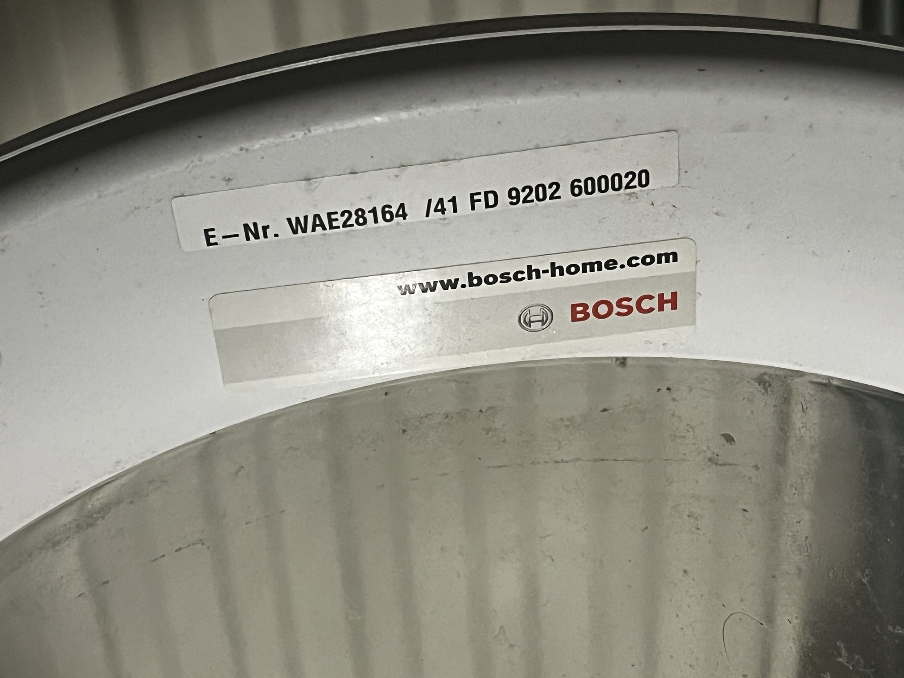
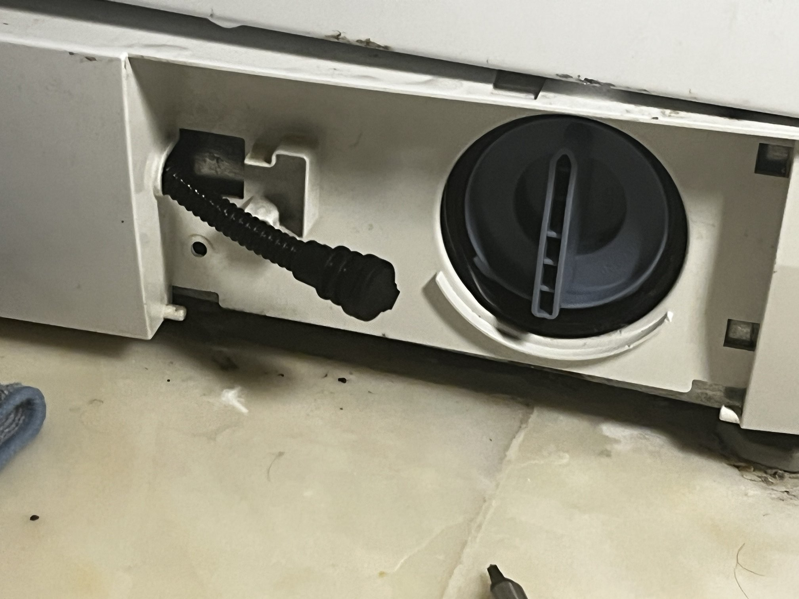
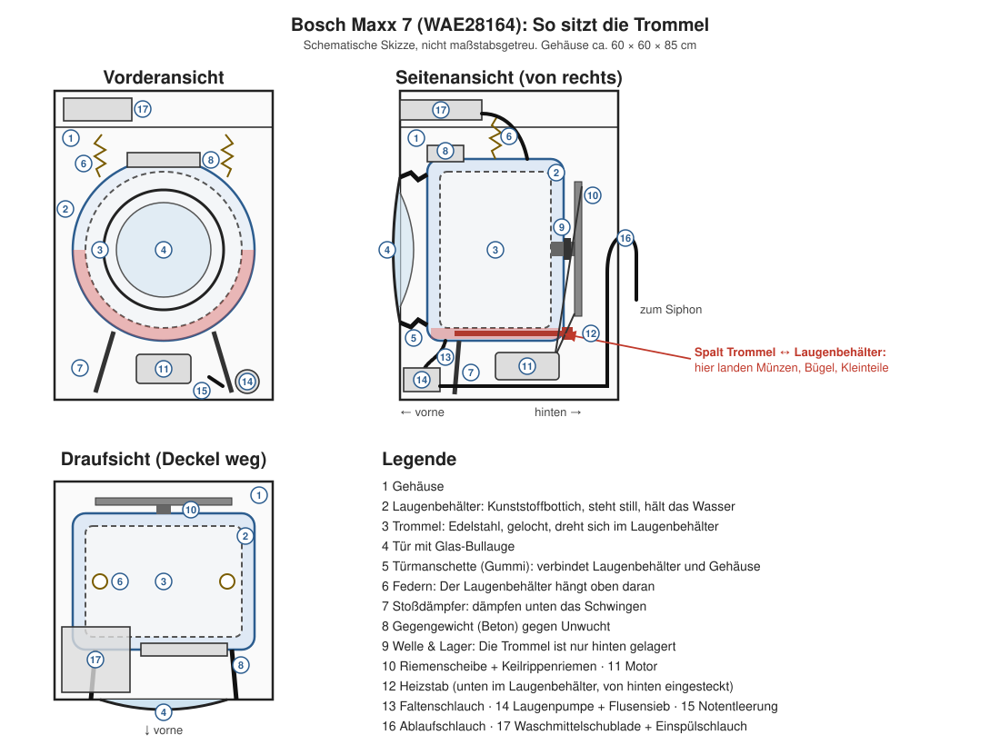

# Waschmaschine reinigen & reparieren

- **Status:** 🔨 In Arbeit (seit 21.11.2026)
- **Priorität:** hoch
- **Raum:** Bad / Waschplatz
- **Budget:** neues Flusensieb + Reiniger

## Gerät
- **Bosch Maxx 7**, E-Nr. **WAE28164/41**, FD 9202 (= Baujahr ca. Feb. 2009)
- Ersatzteile über die E-Nr. suchen (Bosch-Kundendienst oder Ersatzteilshops)

## Aufbau (Skizze)

## Problem
- Wäsche riecht muffig
- Flusensieb komplett mit Fremdkörpern zugesetzt (Münzen, abgebrochene Bleistifte, Plastikteile von Spielzeug), ließ sich nicht mehr herausdrehen
- Pumpenrad dreht frei, mit spürbarer magnetischer Raststellung. Das ist normal und ein gutes Zeichen

## Erledigt (21.11.2026)
- [x] Altes Flusensieb entfernt, **neues Flusensieb** eingesetzt
- [x] Notentleerungsschlauch (kleiner schwarzer Schlauch neben dem Sieb): langer, glasig-schleimiger **Biofilm** herausgezogen
- [x] Waschmittelschublade ausgebaut und gründlich gereinigt
- [x] Schublade und Notentleerung mit Essig + Chlorreiniger behandelt ⚠️ *(siehe Lektion unten)*
- [x] Dr. Beckmann Waschmaschinen-Reiniger in die Trommel gegeben

## Nächste Schritte
- [ ] Gut lüften, Verschlusskappe der Notentleerung fest drauf, Sieb ganz eingedreht
- [ ] **Leere Kochwäsche mit 90 °C** und dem Dr. Beckmann Reiniger. Ohne vorher abzupumpen, sonst wäre der Reiniger weg. Dabei Fenster auf, Tür zu und nicht im Raum bleiben
- [ ] **Türmanschette** (Gummi) prüfen: Falten auseinanderziehen, Schleim und Schimmel abwischen
- [ ] Nach dem Lauf: Flusensieb noch einmal kontrollieren
- [ ] Nach ca. 17 Jahren ohne Grundreinigung: **2–3 leere Durchgänge mit 90 °C** einplanen, z. B. an mehreren Tagen hintereinander, beim 2. und 3. mit Vollwaschmittel als Pulver
- [ ] Mit der Taschenlampe **oben in den Schubladenschacht** leuchten. An dessen Decke, an den Wasserdüsen, sitzt oft schwarzer Schimmel. Mit einer alten Zahnbürste abschrubben
- [ ] Test mit normaler Wäsche: Riecht sie noch?
- [ ] Falls sie noch riecht: Ablaufschlauch hinten und den Anschluss am Siphon prüfen bzw. reinigen

## Rumpeln beim Schleudern (manchmal)
- [ ] **Leer schleudern:** Ist es dann ruhig, liegt es an Unwucht durch die Beladung und ist harmlos. Rumpelt es auch leer, kommen Lager oder Stoßdämpfer in Frage
- [ ] **Spieltest (Stecker raus):** Trommel oben greifen und kräftig hoch und runter drücken. Spürbares Spiel oder Klacken spricht für einen Lagerschaden
- [ ] **Drehtest:** Trommel schnell von Hand drehen. Mahlen oder Rauschen spricht für einen Lagerschaden
- [ ] **Dämpfertest:** Trommel durch die Tür kräftig nach unten drücken und loslassen. Sie sollte ruhig zurückkommen. Federt sie nach, sind die Stoßdämpfer verschlissen (Ersatz ca. 20–30 €, gut selbst zu wechseln)
- [ ] Maschine mit der Wasserwaage prüfen, Füße kontern, Maschine darf nicht wackeln
- Wenn es das Lager ist, lohnt sich keine Reparatur mehr, dann wird eine neue Maschine gekauft (siehe Entscheidung)

## Fremdkörper hinter der Trommel?
- [ ] **Hörtest:** Stecker ziehen, Trommel langsam von Hand in beide Richtungen drehen. Hört man Kratzen, Klappern oder Klirren?
- [ ] Mit einer Taschenlampe durch die Trommellöcher schauen, vor allem unten
- [ ] Beim nächsten Schleudern auf Rasseln achten
- [ ] **Socke oder Stoff?** Den Hörtest bemerkt das nicht. Türmanschette unten zurückziehen und mit der Taschenlampe in den Spalt leuchten
- [ ] Wenn es nach der Kochwäsche immer noch riecht: mit einer **Endoskopkamera** (USB, ca. 15–25 €) durch die Öffnung des Flusensiebs oder des Heizstabs nachsehen
- [ ] Nur wenn etwas zu hören ist: Rückwand abschrauben, **Heizstab ausbauen** und den Fremdkörper durch die Öffnung herausfischen. Vorher Dichtung des Heizstabs als Ersatzteil besorgen

## Damit es nicht wiederkommt
- Taschen leeren, auch bei Kindersachen. Kleinteile in einem Wäschenetz waschen
- Mindestens einmal im Monat mit **60 °C und Vollwaschmittel als Pulver** waschen (das Bleichmittel darin tötet den Biofilm ab)
- Alle 1–2 Monate eine leere Hygienewäsche mit 90 °C
- Weichspüler und Flüssigwaschmittel sparsam verwenden, weil sie Biofilm fördern
- Nach dem Waschen **Tür und Schublade offen lassen**
- Flusensieb alle 2–3 Monate reinigen

## Entscheidung (21.11.2026)
**Die Maschine läuft weiter, solange sie funktioniert.** Pflege und Reinigung ja, größere Reparaturen nein, zum Beispiel Lager, Motor, Elektronik oder Heizstab tauschen. Bei einem größeren Defekt wird eine neue Maschine gekauft.

## Lektion
⚠️ **Nie Essig (oder andere Säuren) mit Chlorreiniger mischen**, weil dabei Chlorgas entsteht. Immer nur **ein** Mittel verwenden und danach mit Wasser nachspülen.
